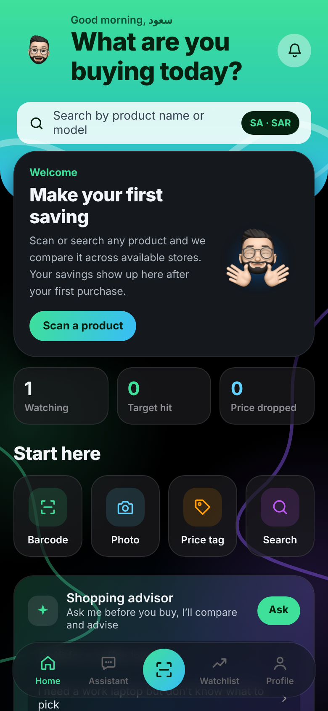
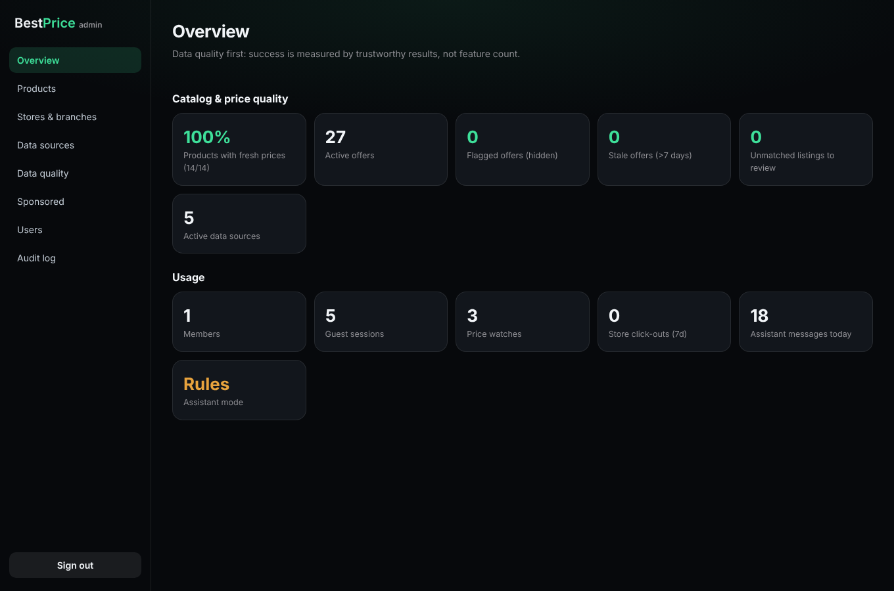

# Best Price — مساعد التسوّق الذكي

**Best Price** تطبيق يساعد المستهلك يقرر وش يشتري ومن وين، بأفضل قيمة فعلية: يمسح الباركود، يقارن العروض بين المتاجر القريبة والإلكترونية، يراقب الأسعار، ويحتوي على مستشار شراء ذكي يتناقش مع المستخدم ويعطيه توصيات مبنية على **بيانات حقيقية** لا على تخمين.

> Best Price is a smart shopping companion: scan or search a product, compare real offers across nearby and online stores, track prices, and talk to an AI shopping advisor whose prices, stores and links always come from the database — never from the model.

---

## ما الموجود في هذا المستودع

| الجزء | المسار | التقنية | الوصف |
|---|---|---|---|
| تطبيق الجوال | `apps/mobile` | Expo (React Native) + Expo Router | iOS / Android (ومعاينة ويب). عربي/إنجليزي مع RTL، مطابق لتصميم **Best Price 2A** |
| الخادم (API) | `apps/api` | Node.js + Fastify + PostgreSQL (Drizzle) | الحسابات، الكتالوج، ترتيب العروض، المسح، التنبيهات، المساعد الذكي، لوحة الإدارة |
| لوحة الإدارة | `apps/admin` | React + Vite | إدارة المنتجات والمتاجر والفروع ومصادر البيانات ومراقبة الجودة |
| المكتبة المشتركة | `packages/core` | TypeScript | الأسواق والعملات، التحقق من الباركود، فحص روابط QR، خوارزمية الترتيب، سجل الأسعار، محرك التوصيات |

## ميزات النسخة الأولى (MVP) — مقابل المتطلبات

1. ✅ تطبيق جوال عربي/إنجليزي مع تبديل فوري لاتجاه الكتابة.
2. ✅ حساب اختياري: يبدأ المستخدم كضيف، ويقدر يحوّل حسابه لعضوية بدون ما يخسر بياناته.
3. ✅ مسح الباركود و QR (مع فحص أمان الروابط) + إدخال يدوي + بحث بالاسم.
4. ✅ صفحة منتج بالمواصفات ومصدرها، والعروض، وسجل السعر.
5. ✅ مقارنة أسعار بأربع طرق ترتيب (أفضل قيمة، الأرخص، الأقرب، الأسرع) مع شرح سبب الترتيب، والسعر النهائي شامل الشحن، ووقت التحديث ودرجة الموثوقية.
6. ✅ الفروع القريبة والمسافة (الموقع يُستخدم لحظيًا ولا يُحفظ).
7. ✅ مساعد ذكي للمحادثات المفتوحة (Claude) مع وضع احتياطي يعمل بدون مفتاح API.
8. ✅ محادثة مرتبطة بمنتج، وإضافة منتج ثاني للمقارنة.
9. ✅ توصيات حسب الاحتياج والميزانية (أفضل قيمة / الأرخص المناسب / يستاهل الزيادة؟).
10. ✅ قائمة متابعة وتنبيهات وصول السعر المستهدف (إشعارات push).
11. ✅ مصدر كل سعر وتاريخ تحديثه، والفصل بين «معلومات مؤكدة» و«رأيي وتوصيتي».
12. ✅ لوحة إدارة: المنتجات، المتاجر، الفروع، مصادر البيانات (مع شرط توثيق الأساس القانوني)، الأسعار الشاذة، القوائم غير المطابقة، الإعلانات، المستخدمين، سجل التدقيق.

البحث بالصورة وقراءة ملصق السعر (OCR) جاهزة في الواجهة كمدخل، والتطبيق يوضح للمستخدم بصراحة أنها قادمة في التحديث القادم بدل ما يعرض نتائج غير دقيقة.

## تشغيل المشروع محليًا

المتطلبات: Node.js 20.19+ و PostgreSQL 16.

```bash
npm install

# 1) قاعدة البيانات والخادم
cp apps/api/.env.example apps/api/.env      # عدّل JWT_SECRET و ADMIN_PASSWORD (و ANTHROPIC_API_KEY اختياري)
npm run db:seed -w @bestprice/api            # ينشئ الجداول + حساب المدير + بيانات تجريبية واضحة
npm run dev:api                              # http://localhost:4000

# 2) لوحة الإدارة
npm run dev:admin                            # http://localhost:5173

# 3) تطبيق الجوال
npm run dev:mobile                           # امسح رمز Expo، أو اضغط w للمعاينة على الويب
```

أو كل شيء عبر Docker: انظر `docker-compose.yml`.

**الاختبارات:** `npm test` (يحتاج قاعدة `bestprice_test`، أو اضبط `TEST_DATABASE_URL`). **فحص الأنواع:** `npm run typecheck`.

## المساعد الذكي

- يعمل بنموذج `claude-opus-5-5` عند ضبط `ANTHROPIC_API_KEY`، مع تفعيل التحويل التلقائي لنموذج احتياطي عند الرفض.
- لا يذكر المساعد أي سعر أو متجر أو توفر إلا من أدوات تقرأ من قاعدة البيانات (`search_products`, `get_offers`, `get_price_history`, `recommend_products`...). بطاقات المنتجات تُعبّأ أسعارها ومتاجرها من الخادم، وأي منتج لم يأتِ من الأدوات يُحذف.
- الإجابة منظمة: نص المحادثة، «معلومات مؤكدة»، «رأيي وتوصيتي»، المصادر، بطاقات توصية، واقتراحات ردود.
- بدون مفتاح API أو عند تعطل الخدمة، يرد مستشار احتياطي مبني على قواعد يستخدم نفس البيانات الحقيقية.
- حد يومي للرسائل حسب الخطة (مجانية / Pro).

## الوثائق

- [`docs/ARCHITECTURE.md`](docs/ARCHITECTURE.md) — البنية ونموذج البيانات وتدفق الطلبات.
- [`docs/SECURITY.md`](docs/SECURITY.md) — الحماية المطبّقة وقائمة التحقق قبل الإطلاق.
- [`docs/DATA_SOURCES.md`](docs/DATA_SOURCES.md) — مصادر البيانات القانونية، صيغة الاستيراد، المطابقة وجودة البيانات.
- [`docs/ROADMAP.md`](docs/ROADMAP.md) — ما بعد النسخة الأولى ومؤشرات النجاح.
- [`docs/LAUNCH.md`](docs/LAUNCH.md) — خطة الإطلاق والانتشار الإعلامي.

## مهم قبل الإطلاق

الأسعار في قاعدة البيانات الحالية **تجريبية** (مصدرها من نوع `demo`) ويظهر ذلك بوضوح داخل التطبيق. قبل الإطلاق يجب ربط مصادر حقيقية ومسموح بها (واجهات API رسمية، كتالوجات شركاء، برامج تسويق بالعمولة) — التفاصيل في `docs/DATA_SOURCES.md`.

---

التصميم والفكرة: سعود محمد الحنيني © 2026

## لقطات

| الرئيسية | المستشار | محادثة عن منتج | قائمة المتابعة |
|---|---|---|---|
|  |  |  |  |

| English | البداية | صفحة المنتج | العروض |
|---|---|---|---|
|  |  |  |  |


